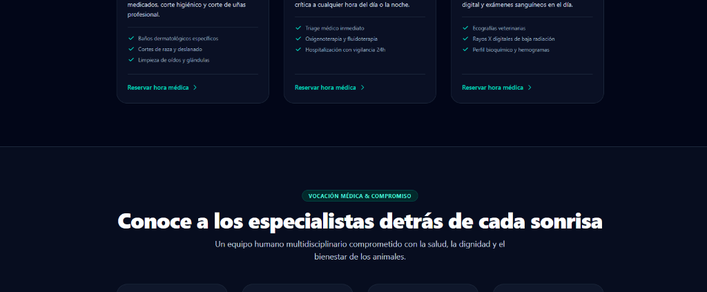
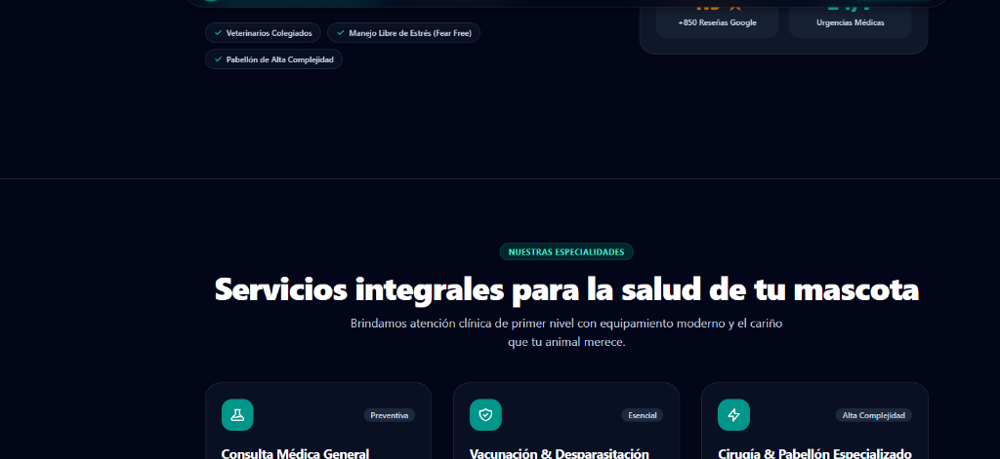

# Clínica Veterinaria Huellitas 🐾

> Landing page médica de alta conversión y portal clínico interactivo de agendamiento para mascotas. Diseñada y desarrollada con arquitectura estática ultra-rápida (SSG), modo nocturno integral, accesibilidad WCAG y cero frameworks pesados.

[](https://astro.build)
[](https://tailwindcss.com)
[](https://huellitas-vet.pages.dev)
[](https://developer.mozilla.org/es/docs/Web/JavaScript)
[](LICENSE)

---

### 🌐 Demo en Vivo y Producción
👉 **Explora el sitio en producción:** **[https://huellitas-vet.pages.dev](https://huellitas-vet.pages.dev)**  
*(Desplegado en la red global CDN de Cloudflare Pages con compilación e integración continua automática).*

---

## 📸 Vistas del Proyecto

| Landing Page (Hero y Servicios) | Portal Clínico de Agendamiento (`/agendar`) |
| :---: | :---: |
|  |  |

---

## 📑 Tabla de Contenidos
- [🎯 Propósito del Proyecto](#-propósito-del-proyecto)
- [✨ Características Principales](#-características-principales)
- [🏛️ Arquitectura y Decisiones Técnicas](#️-arquitectura-y-decisiones-técnicas)
- [🛠️ Stack Tecnológico](#️-stack-tecnológico)
- [🚀 Instalación y Ejecución Local](#-instalación-y-ejecución-local)
- [📂 Estructura del Proyecto](#-estructura-del-proyecto)
- [🗺️ Hoja de Ruta y Próximos Pasos (Roadmap)](#️-hoja-de-ruta-y-próximos-pasos-roadmap)
- [👨‍💻 Autor y Licencia](#-autor-y-licencia)

---

## 🎯 Propósito del Proyecto

Este proyecto forma parte de mi **portafolio profesional de desarrollo web** y fue concebido con un doble propósito:
1. **Proyecto de Aprendizaje y Buenas Prácticas:** Demostrar el dominio del ecosistema moderno de frontend con **Astro 5** y **Tailwind CSS v4**, priorizando el rendimiento, la accesibilidad (a11y) y el código limpio en JavaScript nativo.
2. **Caso de Uso Real (Negocio Clínico):** Resolver una necesidad real de clínicas veterinarias: captación de pacientes mediante una landing cálida y empática, junto a un flujo de agendamiento médico sin fricción ni recargas de página.

---

## ✨ Características Principales

### 🩺 1. Portal Clínico de Agendamiento Interactivo (`/agendar`)
- **Flujo Guiado en 4 Pasos:** Especialidad médica ➔ Profesional tratante ➔ Fecha y bloque horario ➔ Datos del tutor y mascota.
- **Validaciones Clínicas Dinámicas:** Restricción de especie según el servicio (ej. Peluquería Canina solo admite perros; Felina solo gatos), filtrado automático de doctores por especialidad y bloqueo estricto de domingos para consultas ambulatorias (con derivación a urgencias).
- **Modal Inteligente de Abandono:** Previene la pérdida accidental de datos si el tutor intenta salir del flujo antes de finalizar su reserva.
- **Comprobante Médico con QR Vectorial:** Ficha médica con folio único, resumen de atención y código QR SVG sin librerías externas pesadas.
- **Modo Impresión Aislado (`@media print`):** Optimizado para imprimir directamente la receta/comprobante en PDF o papel físico, ocultando encabezados, barras de navegación y fondos innecesarios.

### 🌓 2. Modo Nocturno Integral (Dark Mode)
- **Cero Parpadeo (Anti-FOUC):** Script síncrono ultra-liviano en `<head>` que lee la preferencia antes de pintar el DOM.
- **Persistencia en `localStorage`:** Recuerda la elección del usuario y se adapta a las preferencias del sistema operativo (`prefers-color-scheme`).
- **Paleta Accesible:** Tonos Slate oscuros con contrastes verificados WCAG AA para lectura cómoda en emergencias nocturnas.

### 🗺️ 3. Contacto, Ubicación y Atención de Urgencias
- **Formulario de Contacto Equilibrado:** Diseño a altura completa con validación nativa de campos y protección antispam mediante **Honeypot silencioso** (cero fricción de CAPTCHAs para el usuario).
- **Mapa Interactivo con Zoom de Precisión:** Integración de OpenStreetMap centrada en Providencia, Santiago.
- **Botón Flotante Móvil de Urgencias:** Acceso directo con un solo toque (`tel:+56912345678`) visible permanentemente en pantallas móviles.

### 🔍 4. SEO Técnico y Datos Estructurados
- **Google Rich Results:** Marcado semántico estructurado **Schema.org** tipo `VeterinaryCare` con geolocalización, teléfono, horarios y catálogo de especialidades.
- **Social Sharing:** Meta etiquetas Open Graph y Twitter Cards dinámicas para previsualizaciones ricas al compartir en WhatsApp, Twitter y LinkedIn.
- **Archivos Estándar:** `robots.txt` y cabeceras canónicas generadas automáticamente.

---

## 🏛️ Arquitectura y Decisiones Técnicas

| Decisión | Justificación Técnica | Alternativa Descartada |
| :--- | :--- | :--- |
| **Astro 5 (SSG)** | Genera HTML puro compilado en el build. Cero consumo de CPU en el servidor y velocidad de carga instantánea (TTFB < 50ms). | Next.js / SSR tradicional (innecesario para un sitio que no requiere render dinámico por petición). |
| **Vanilla JavaScript** | Toda la reactividad del agendamiento y modales se construyó con JS nativo (`document`, eventos, `localStorage`). Cero kilobytes de React, Vue o librerías pesadas en el bundle final. | React / Vue / Svelte (añaden peso innecesario al cliente para interacciones manejables con DOM nativo). |
| **Tailwind CSS v4** | Adopta el nuevo motor `@tailwindcss/vite`, eliminando configuración compleja y reduciendo el tiempo de compilación a milisegundos. | Tailwind v3 clásico / SASS. |
| **Costo Cero ($0 USD)** | Alojamiento en Cloudflare Pages, código fuente en GitHub y optimización de activos locales con `astro:assets` (imágenes WebP locales sin dependencias de CDNs de pago). | Servidores dedicados o servicios de pago. |

---

## 🛠️ Stack Tecnológico

- **Framework Principal:** [Astro 5+](https://astro.build)
- **Motor de Estilos:** [Tailwind CSS v4](https://tailwindcss.com) + `@tailwindcss/vite`
- **Lenguaje:** JavaScript moderno (ES6+, módulos nativos `.js` / `.mjs`)
- **Linter y Formateo:** [ESLint v9 LTS](https://eslint.org) + [Prettier](https://prettier.io) con plugins oficiales de Astro
- **Infraestructura y Despliegue:** [Cloudflare Pages](https://pages.cloudflare.com) (CI/CD conectado a GitHub)
- **Mapas:** [OpenStreetMap](https://www.openstreetmap.org)

---

## 🚀 Instalación y Ejecución Local

Si deseas clonar este proyecto para estudiarlo, utilizarlo como base o evaluarlo, sigue estos sencillos pasos:

### 1. Prerrequisitos
- **Node.js**: v20+ o v22+ LTS instalada.
- **Git** instalado.

### 2. Clonar el repositorio
```bash
git clone https://github.com/JCarvajalLab/astro-landing-veterinaria.git
cd astro-landing-veterinaria
```

### 3. Instalar dependencias
```bash
npm install
```

### 4. Iniciar el servidor local de desarrollo
```bash
npm run dev
```
Abre tu navegador en `http://localhost:4321`.

### 5. Scripts disponibles
```bash
# Compilar para producción (genera la carpeta /dist)
npm run build

# Previsualizar la compilación de producción localmente
npm run preview

# Ejecutar linter con ESLint
npm run lint

# Verificar formato de código con Prettier
npm run format:check

# Corregir formato automáticamente
npm run format
```

---

## 📂 Estructura del Proyecto

```text
astro-landing-veterinaria/
├── .agents/skills/       # Guías operativas y especialistas de Antigravity
├── docs/                 # Documentación técnica, capturas, PLAN.md e HISTORIAL.md
│   └── screenshots/      # Imágenes y capturas de pantalla para el portafolio
├── public/               # Archivos estáticos servidos directamente (favicon, og-image, robots.txt)
├── src/
│   ├── assets/           # Fotografías e imágenes optimizadas automáticamente a WebP
│   │   ├── team/         # Fotografías del equipo médico veterinario
│   │   └── testimonials/ # Fotos reales de pacientes
│   ├── components/       # Componentes modulares .astro (Hero, Services, BookingModal, Contact, etc.)
│   ├── layouts/          # Layout base con cabeceras SEO, fuentes y script anti-parpadeo
│   ├── pages/            # Rutas del sitio (index.astro, agendar.astro, 404.astro)
│   └── styles/           # Configuración de estilos globales y temas con Tailwind v4
├── astro.config.mjs      # Configuración de Astro y plugin Vite
├── package.json          # Dependencias y scripts de ejecución
└── README.md             # Esta documentación
```

---

## 🗺️ Hoja de Ruta y Próximos Pasos (Roadmap)

Este proyecto fue planificado con una arquitectura escalable. Las siguientes mejoras están contempladas para una futura iteración Full Stack:

- [ ] **Persistencia en Base de Datos:** Migración de citas a **PostgreSQL** o **Cloudflare D1** para almacenar historiales clínicos y horarios en tiempo real.
- [ ] **Astro Actions & Backend:** Validación de datos en servidor con esquemas `Zod` y endpoints de API seguros.
- [ ] **Notificaciones Transaccionales:** Envío automático de confirmaciones por correo electrónico (vía Resend) y recordatorios por WhatsApp Business API.
- [ ] **Pasarela de Pago Online (Sandbox):** Integración de cobro de reserva o copago mediante Webpay Plus o Stripe en modo pruebas.
- [ ] **Panel de Administración (Backoffice):** Dashboard con autenticación para que los veterinarios gestionen su disponibilidad y pacientes del día.

---

## 👨‍💻 Autor y Licencia

Desarrollado con dedicación por **Jordan Carvajal** ([@JCarvajalLab](https://github.com/JCarvajalLab)) como parte de mi portafolio profesional de desarrollo web.

Este proyecto está bajo la Licencia **MIT**. Puedes usarlo libremente para tu propio aprendizaje, proyectos personales o adaptaciones profesionales.

---
⭐ *Si este proyecto te resultó útil o interesante para aprender Astro y Tailwind, no dudes en dejarle una estrella en GitHub.*
